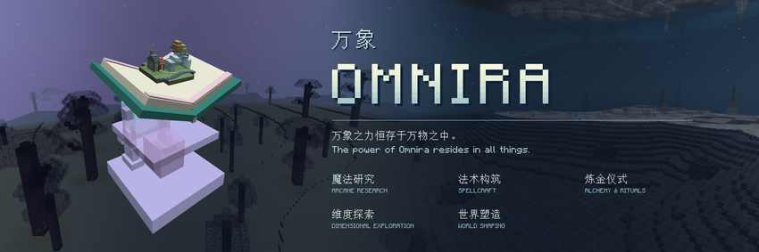

# Omnira · 万象

[中文](#中文) · [English](#english) · [Issues](https://github.com/MidnightPigeon/Omnira/issues) · [作者主页 / Author's website](https://midnightpigeon.github.io/) · [联动开发 / Integration reference](INTEGRATION.md)

## 中文

**万象之力恒存于万物之中。**

万象（Omnira）是一个围绕魔法研究、探索与创造展开的 Minecraft 模组。你需要凝聚自身的灵性获取水晶，解析世界以获得元素微核，编写属于自己的法术，踏入陌生的维度，逐步掌握改变世界的力量。

法术、炼金、仪式与魔动器械共同构成你的研究旅程。游戏内的指导书（以及一个神秘的引导魔球）会随流程介绍各项内容，并提供配方、图文说明和可交互的结构展示，帮助你将发现化为实践。

> 当你走过这条道途，你将能理解并编辑一切，“我的世界”（Minecraft）也将成为“你的世界”（Yourscraft）。

### 你可以在万象中体验

- **魔法研究**——认识各类魔法材料，提升自身法力，搭建以魔力供能的器械，进行优雅或狂野的制造、施法……也许还有爆炸！
- **法术构筑**——组合微核、要素与修饰，决定法术的形态、效果与变化。我们拥有很自由的组合方式，所以开始发挥你的想象力吧！*（又及：我要在此致敬 MNA，这一模组为我的创意和设定提供了不可磨灭的灵感贡献。真希望能在 1.21 延续这份体验。）*
- **炼金仪式**——利用炼金锅进行材料转化，通过神秘的方式达成持续生产，基于仪式与世界内的魔力共鸣，这将帮助你解开这个世界的秘密，也将助你获得无穷无尽的基础材料！
- **维度探索**——穿越梦境中的光明、镜面与黑暗，探索时间与空间交织的大地，发现奇异生物、前人遗迹和珍藏。是的，我们拥有完整的两个维度，大量的新群系，各种神秘的结构，以及存在完整世界观的各种设定！全新的世界在等待你们尽情探索！
- **世界塑造**——*玩家的终极能力*将会走向构建并演化微缩世界，最终获得万象原典，以物质替换、形体铺设和生态构筑改变眼前的世界。*在这一刻，你就是创世主*——至少在魔力影响范围内是。

### 在主要内容之外，我们还有……

- 水晶存储、共振物流与可配置的升级，让各项成果能够彼此连接。*我说超空间传输就是比锁链传输要好用，谁赞成谁反对？*
- **能源互通！** 本模组的“魔力脉冲势能”（MPU）可以无损等量转化为机械动力的 SU 与电力的 FE/s，使用完全相同的输出端，并且会依据输出的能源产生不同的动画效果！
- 原创环境音乐，为不同阶段的旅程赋予独特的氛围。当然，它们大概并不是很长的音频……
- 来自其他世界线的奇珍异宝——猜猜都有什么呢？
- *疯狂*的模组联动！除了必须的 Curios API 之外，作为魔法模组，我们首先联动了*机械动力*与*机械动力：航空学*！至于为什么？因为飞上天空是一种无法拒绝的浪漫！
- 即将到来的整合包。没错，这个模组是为了我未来的整合包编写的，但是它仍然可以被独立使用！

下载模组，打开书本，带上你的好奇心与智慧，去探索吧！我将我（这段创作周期内）的所有宝藏都放在了那里！

### 安装与版本

| 项目 | 要求 |
| --- | --- |
| Minecraft | **仅 1.21.1** |
| 加载器 | **NeoForge 21.1.235 或以上的 21.1.x 版本** |
| Java | **Java 21**；更高版本未验证 |
| 必需依赖 | **Curios API 9.5.1 或以上的 9.x 版本**（Minecraft 1.21.1 / NeoForge） |

安装对应版本的 NeoForge，将 Omnira 与 Curios API 的 JAR 放入游戏的 `mods` 文件夹即可。机械动力、航空学、JEI 等为可选联动，不是独立游玩本模组的前置要求。

### 常见疑问

**会有 Fabric 版本吗？**  
我自己没有制作 Fabric 版本的计划，但欢迎其他人进行移植。请注明原作者。

**会与更多模组联动吗？**  
未来会有，但具体取决于我自己的需求——即将制作的整合包肯定会带来一些新需求。也欢迎任何人编写联动性质的附属模组。

**会向低版本移植吗？**  
我自己移植的可能性是零，因为我要玩航空学。不过，其他人可以自由移植，无论是更低还是更高的 Minecraft 版本。

**如何反馈 Bug？**  
在项目的 [GitHub Issues](https://github.com/MidnightPigeon/Omnira/issues) 中提交问题即可，游戏内指导书也提供了直达链接。对于无法访问 GitHub 的中文玩家，通过我的 Bilibili 视频找到并加入群聊，也许是更可靠的反馈方式。

**可以使用模组的资源吗？**  
可以。本项目的代码与自有资源采用 [MIT 许可证](LICENSE)，**包括美术与音频资源！** 欢迎使用和修改；请注明来源，并保留版权声明与许可声明。第三方依赖与第三方素材仍遵循各自许可。

**如何联系作者？**  
指导书也提供了[作者主页](https://midnightpigeon.github.io/)的直达链接，主页内包含联系邮箱。如需直接联系我，请使用邮件。

**有什么需要特别注意的吗？**  
本模组中有大量使用半透明材质的物品与方块，会带来一定的渲染开销。因此，不建议在小范围内密集堆叠大量魔动器械。部分模组搭配也可能存在兼容风险，具体请查看游戏内指导书中的说明。

联动与整合包作者请参阅[联动开发说明](INTEGRATION.md)，包含配方格式、KubeJS 示例、自动化接口与兼容边界。

## English

**The power of Omnira resides in all things.**

Omnira is a Minecraft mod centered on magical research, exploration, and creation. Condense your own spiritual essence into crystals, analyze the world to obtain elemental microcores, compose your own spells, venture into unfamiliar dimensions, and gradually master the power to change the world.

Spellcraft, alchemy, rituals, and magically powered machinery come together throughout your research journey. An in-game guidebook—and a mysterious guiding orb—introduces these systems as you progress, providing recipes, illustrated explanations, and interactive structure previews to help turn your discoveries into practice.

> Walk this path, and you will come to understand and rewrite everything. Minecraft will become Yourscraft.

### Discover what awaits you in Omnira

- **Arcane Research** — Study magical materials, develop your mana, and build magically powered devices. Craft and cast with elegance—or abandon all restraint. There may also be explosions!
- **Spellcraft** — Combine microcores, elements, and modifiers to determine your spells’ forms, effects, and variations. There is plenty of freedom to experiment, so let your imagination take over! *(A personal tribute to Mana and Artifice: this mod has been an unforgettable source of inspiration for my ideas and designs. I only wish I could bring that experience with me to 1.21.)*
- **Alchemy & Rituals** — Transform materials in alchemical cauldrons, uncover mysterious methods of continuous production, and perform rituals that resonate with the magic of the world. These discoveries will help you unravel its secrets—and secure an endless supply of basic materials!
- **Dimensional Exploration** — Journey through the light, mirrors, and darkness of dreams, then explore lands where time and space intertwine. Encounter unusual creatures, forgotten ruins, and hidden treasures. Two fully realized dimensions await, filled with new biomes, mysterious structures, and interconnected lore. There are whole new worlds for you to explore!
- **World Shaping** — *Your ultimate power* lies in constructing and evolving miniature worlds, culminating in the Myriad Codex. Replace materials, build geometric forms, and create miniature ecosystems to transform the world before you. *At that moment, you become a creator of worlds*—at least within the reach of your magic.

### And beyond the main journey, there is more…

- Crystal storage, resonance-based logistics, and configurable upgrades connect your creations into a working whole. *I say hyperspatial transport beats hauling things around on chains. Who’s with me?*
- **Interchangeable Energy!** Omnira’s Mana Pulse Potential (MPU) converts into Create’s Stress Units (SU) and Forge Energy per second (FE/s) at a lossless 1:1 ratio—all through the same output interface, with distinct animations for each energy type!
- Original ambient music gives each stage of your journey its own atmosphere. Admittedly, these tracks may not be especially long…
- Curious treasures from other timelines. Care to guess what you might find?
- *Wild* mod integrations! Beyond the required Curios API, the first integrations for this magic mod are with *Create* and *Create: Aeronautics*. Why? Because the romance of taking to the skies is impossible to resist!
- An upcoming modpack. That’s right: Omnira was created for a future modpack of mine, but you can absolutely enjoy it on its own!

Download the mod, open the book, and bring your curiosity and ingenuity. Go explore! Every treasure I have gathered throughout this creative journey is waiting for you in there.

### Installation and versions

| Component | Requirement |
| --- | --- |
| Minecraft | **1.21.1 only** |
| Mod loader | **NeoForge 21.1.235 or a later 21.1.x release** |
| Java | **Java 21**; newer versions have not been verified |
| Required dependency | **Curios API 9.5.1 or a later 9.x release** for Minecraft 1.21.1 / NeoForge |

Install the matching NeoForge version, then place the Omnira and Curios API JARs in your game’s `mods` folder. Create, Aeronautics, JEI, and other integrations are optional; they are not required to play Omnira on its own.

### Frequently asked questions

**Will there be a Fabric version?**  
I have no plans to make a Fabric version myself, but others are welcome to port the mod. Please credit the original author.

**Will there be more mod integrations?**  
Yes, but future integrations will depend on my own needs—and my upcoming modpack will certainly create some! Anyone is also welcome to develop integration addons.

**Will you backport the mod?**  
The chance of me backporting it is zero: I want to play with Create: Aeronautics! However, others are free to port the mod to either older or newer Minecraft versions.

**How do I report bugs?**  
Please open an issue on [GitHub](https://github.com/MidnightPigeon/Omnira/issues). The in-game guidebook also links directly to the repository. For Chinese-speaking players who cannot access GitHub, joining the community group through my Bilibili videos may be a more reliable way to reach me.

**May I reuse the mod’s assets?**  
Yes! The project’s code and original assets are released under the [MIT License](LICENSE), **including its artwork and audio!** You are welcome to use and modify them. Please credit the source and retain the copyright and permission notices. Third-party dependencies and assets retain their respective licenses.

**How can I contact the author?**  
The guidebook also links to [my personal website](https://midnightpigeon.github.io/), where you can find my email address. If you need to contact me directly, please email me. The website is primarily in Chinese; expand the **Service** table and scroll to the bottom to find my email address.

**Is there anything I should keep in mind?**  
Many items and blocks in Omnira use translucent materials, which can increase rendering overhead. Avoid placing large numbers of magical machines close together in a small area. Some mod combinations may also have compatibility risks; please consult the in-game guidebook for details.

For addon and modpack authors, see the [integration reference](INTEGRATION.md) for recipe formats, KubeJS examples, automation interfaces, and compatibility boundaries.
